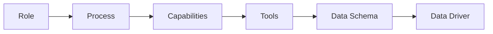

# Dev Pipeline

A layered development pipeline for AI-assisted delivery: roles run processes, processes use capabilities, capabilities call tools, tools publish data against schemas, and data drivers persist or integrate that data.

## Pipeline

```text
Role → Process → Capabilities → Tools → Data Schema → Data Driver
```



| Layer | Purpose | In this repo |
| ----- | ------- | ------------ |
| **Role** | Who acts (e.g. system analyst, architect, project manager) | Grouped under `skills/abilities/<role>/` |
| **Process** | End-to-end workflow the role follows | `skills/processes/` |
| **Capabilities** | Reusable skills that implement process steps | `skills/abilities/` |
| **Tools** | Concrete technologies and runtimes used by capabilities | `skills/technologies/` |
| **Data Schema** | Contracts for published artifacts (cards, sections, components) | `.schemas/` |
| **Data Driver** | Persistence / integration that reads and writes data per schema | External to this package (consumer-specific) |
